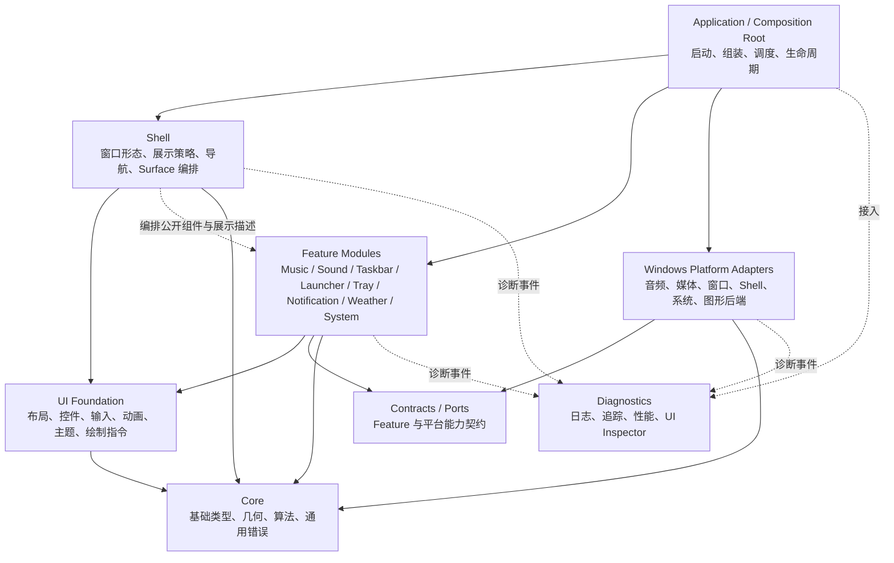
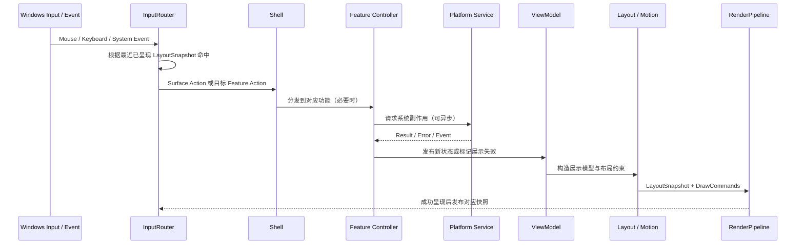

# IslandBar 整体架构设计基线（Architecture V1）

> **状态：PROPOSED（待确认，尚未封板）**  
> **文档类型：目标架构与渐进式迁移设计**  
> **编写日期：2026-10-15**  
> **适用工程：** Zig + Win32 + Direct2D / DirectWrite + DirectComposition 的 IslandBar 原生桌面程序  
> **依据：** 当前讨论确定的长期目标，以及 `res.zip` 中的 `build.zig`、`src/`、`setup/`、`tools/` 等现有工程结构。

> **目录说明（2026-10-15）：** 当前代码根目录为仓库内的 `island/`；本文件中的 `build.zig`、`src/`、`setup/`、`tools/`、`res/` 等代码路径均相对于 `island/`。此说明不改变本文的 `PROPOSED` 状态或目标架构。

## 0. 文档定位与执行约束

本文件定义 **IslandBar 希望逐步演进到的架构**，**不代表当前代码已经实现**。本文中的目录、模块、接口名称是设计候选，实际迁移时允许在不改变职责和依赖规则的前提下调整命名或合并简单结构。

**重要：本文件不是一次性重写指令。** 未经项目维护者确认，不得仅凭本文自动大规模移动、删除或修改现有代码。AI / Codex 参与时，应先分析现状、提出改动边界和影响评估，再按获准的阶段实施。优先保留现有可运行功能、现有外观和交互习惯。项目其他开发约束若更严格，应同时遵守。

本文的架构结论分为：

- **原则（Normative）**：架构边界、所有权、单向数据流、同帧布局一致性等，是重构过程中需要遵守的长期规则。
- **候选设计（Proposed）**：文件组织、具体类型/模块命名、部分 UI 抽象形式；待实现前通过实际代码验证。
- **待决事项（Open）**：需要基于性能、复杂度和现有实现评估后确定，不应提前强行落地。

本文适用于后续新增功能与存量迁移，也供 Codex 在分析和修改前读取。每个阶段都应维持可编译、可运行、可回退。

---

## 1. 架构目标、范围与非目标

### 1.1 核心目标

1. **局部修改**：调整音乐卡片的字号、间距、颜色或布局，原则上只触及该 UI 组件及其局部样式；不需要修改应用主循环、媒体会话实现和其他页面。
2. **独立扩展**：新功能可以自带状态、控制逻辑、ViewModel 和 UI，通过少量明确的接入点与 Shell 组合，不反复修改既有功能。
3. **可诊断性**：事件、状态转换、平台调用、渲染失败都有明确的责任模块和必要的错误上下文。
4. **高可靠性**：一个非关键功能失败时，尽可能降级处理，而不是使整个 UI 失效。
5. **原生性能**：继续保留 Zig、Win32、Direct2D、DirectWrite、DirectComposition，以及现有安装/发布模式。
6. **清楚的所有权**：明确数据、GPU 资源、COM 对象、事件和分配器的生命周期，避免隐藏共享和悬空指针。
7. **受控复杂度**：适度抽象，不把 IslandBar 重做成通用 Qt、Flutter、浏览器或通用插件宿主。

### 1.2 目前**不**追求

- 不把功能拆成多个独立进程、DLL 或运行时插件。
- 不引入 Electron、WebView 或重型第三方 UI 框架。
- 不必实现完整虚拟 DOM、复杂响应式依赖系统或 ECS。
- 不为每个小型功能强制创建相同数量的 Controller/Service/Repository/Factory 文件。
- 不为了让目录好看而让 Zig `build.zig` 注册成百上千个无意义的模块。
- 不在一次提交中把项目整体重写。
- 不承诺所有跨层变更只修改一个文件；目标是 **变化与影响范围匹配**。

### 1.3 可衡量的成功条件

| 典型开发任务 | 预期主要修改范围 |
| --- | --- |
| 音乐卡片改圆角、字体、间距 | `features/music/ui` 的组件/局部样式 |
| 声音页面改变滑块布局 | `features/sound/ui`，不碰 Windows 音频服务 |
| GSMTC 媒体读取方式调整 | `platform/windows/media`，保持 Music 对外契约 |
| 通知展示优先级调整 | Shell 展示策略，不修改渲染设备层 |
| 新增蓝牙功能及卡片 | 新 Feature + 平台能力适配 + 集中接入点 |
| 设备丢失 | GraphicsBackend 重建设备资源，业务状态不因此重置 |
| 点击错位 | 能通过布局快照、控件 ID 和输入记录定位，不重复排查多份坐标公式 |

---

## 2. 现状概览（基于所提供工程）

现有工程已经按 `app`、`core`、`features`、`ui`、`platform/windows` 等目录组织，并在 `build.zig` 中显式注册和绑定 Zig 模块。**这项显式依赖管理应保留其优点，不应退回任意跨目录导入。**

但物理目录与实际职责仍存在较大偏差：

- `src/app/main.zig` 同时持有大量功能状态、窗口事件、界面行为和系统调用流程；主入口对许多具体功能模块有直接依赖。
- `src/ui/Renderer.zig`、`src/ui/TextRenderer.zig` 直接依赖音乐、天气、通知、启动应用等具体业务模块，渲染层并不纯粹。
- `src/core/CardLayout.zig`、`src/core/TaskStripLayout.zig` 同时承载不同页面或任务栏的专用几何计算；并非全部属于通用 Core。
- 媒体、音频、图标、托盘等场景存在平台实现与功能职责混合的情况；跨功能复用时可能引用其他 Feature 的内部实现。
- Shell 状态、页面状态、过渡动画、输入命中和绘制数据没有足够明确的统一边界。
- `build.zig` 的现有模式偏向“一个源码文件一个命名模块”，利于显式约束，但会使依赖表随文件数增长；目标应是按**稳定边界**设计编译模块。

这些是架构方向问题，不意味着每个现有函数都有错误。具体缺陷的是否成立、准确位置、复现条件，仍须在各阶段按当时源码复核，不应仅凭本文件直接修改。

### 2.1 特别关注的风险

1. `BeginDraw` / `EndDraw`、GPU/COM 资源生命周期以及 Device Lost 恢复。
2. 任务按钮动画几何与输入命中使用不同路径的风险。
3. HWND、图标等缓存项的失效和回收。
4. 启动菜单网格间隙、裁剪区域与真实命中区域的一致性。
5. 可能阻塞 UI 主线程的系统枚举、图标解码、Shell/COM 操作。
6. Shell、Renderer、CardLayout 和入口逻辑之间的显示状态决策重叠。
7. 托盘/窗口关闭等高影响操作的目标身份与操作确认方式。

上述风险应进入审查清单；本文件不宣称已通过 Windows 实机回归验证。

---

## 3. 总体技术路线

**采用：模块化单体（Modular Monolith） + 按功能垂直切分（Feature-Based） + Shell 编排 + 轻量原生 UI 组件基础设施 + Windows 平台适配器。**



> 图中 Feature → UI 指 **Feature 的 UI 展示子模块**，不是业务核心依赖渲染器；Shell → Feature 指消费其**公开的展示/交互契约**，而不是随意访问 Feature 内部状态。图中诊断线是概念关系，不要求到处引入一个复杂运行时总线。

### 3.1 核心设计判断

- **App 是组装者**：可以同时知道 Shell、功能以及 Windows 适配器，但不承载它们的内部行为。
- **Shell 是展示编排者**：控制 IslandBar 整体形态、页面切换、遮挡与抢占策略、Surface 的显示生命周期。
- **Feature 是能力所有者**：维护自身功能状态与业务规则，接受操作并产生明确结果。
- **UI 是可视化基础设施**：提供组件、布局、输入与绘制机制，不认识“当前歌曲”“天气来源”之类具体领域。
- **Platform 是系统能力提供者**：封装 Win32、COM、Core Audio、GSMTC、Shell、D2D 等具体实现。
- **Core / Contracts 稳定而克制**：只放真实跨模块需要共享的类型、能力端口，不放任意业务“公共工具箱”。
- **Diagnostics 贯穿执行链**：可定位、可观测，但不反向控制业务。

### 3.2 编译期模块边界与运行时对象不是同一概念

- **目录**解决开发时定位代码与明确归属。
- **Zig module** 控制编译时能 import 哪些稳定依赖。
- **Feature 实例**是运行时有生命周期和状态的对象。
- **UI 组件实例**是 Shell 布局与输入体系中的展示对象。

不应认为“每个目录必须对应一个 `b.createModule`”，也不应假定“每个 Component 都需要独立的 Window/HWND”。

---

## 4. 模块职责和不可跨越的依赖边界

| 层/模块 | 允许拥有的职责 | 禁止承担的职责 |
| --- | --- | --- |
| `app` | 程序入口、启动顺序、依赖组装、生命周期、任务协调 | 页面绘制、业务规则、逐按钮点击分支 |
| `shell` | 全局展示状态、页面导航、Surface 管理、窗口整体目标几何、显示优先级 | 媒体解析、直接修改 Windows 音量、GPU 资源细节 |
| `features/<name>/core` | 本功能状态、命令、验证、领域规则、服务端口 | `HWND` / D2D COM 细节、具体 UI 绘制、其他 Feature 私有状态 |
| `features/<name>/ui` | 本功能 UI、ViewModel、局部布局和输入到 Action 映射 | 系统枚举、阻塞性 COM 调用、后台线程管理 |
| `ui` | 通用控件、布局快照、事件命中、动画、绘制指令、主题和逻辑资源引用 | 导入 `MusicSession`、`Weather` 等 Feature 实现 |
| `platform/contracts` | 平台能力的窄接口、纯数据传输类型 | Windows 实现、全局 Feature 业务决策 |
| `platform/windows` | Win32/COM/Direct2D 适配实现、资源与线程规则 | Shell 页面选择、应用级导航 |
| `core` | 无平台副作用的基础类型、算法、基础错误类型 | UI 页面、具体功能、Windows API |
| `diagnostics` | 分层错误上下文、日志、性能采样、开发工具 | 改变业务规则与渲染逻辑 |

### 4.1 依赖规则（强约束）

1. `core` 不依赖 App、Shell、Feature、UI 或 Windows。
2. `ui` 的通用基础部分不能 import 具体 Feature 或应用入口。
3. `features/<name>/core` 不能 import `features/<name>/ui`、Shell、Windows 实现或其他 Feature 私有模块。
4. Feature 的 UI 子模块可以依赖本 Feature 的公开状态/展示模型及 UI 基础层。
5. 一个 Feature 需要另一个 Feature 的能力时，优先由 App/Shell 编排；必要时定义明确的公开服务契约，而非引用对方私有文件。
6. 平台适配器实现平台端口；端口定义不能反过来 import Windows 适配器。
7. `RenderPipeline` 不引用 Music、Sound、Weather、Notification 的领域类型。
8. `App` 是已知具体实现的少数边界之一，负责初始化实例与建立依赖关系；它不成为巨型业务控制器。
9. 不通过全局可写变量、万能上下文或通用事件总线绕过上述依赖约束。
10. `build.zig` 继续用显式 import 白名单约束模块方向，并逐步将白名单从“文件级耦合图”收敛到“稳定模块边界图”。

### 4.2 对跨功能共享的处理

共享能力按其真正属性归属：

- “获取应用/窗口图标”是通用系统能力时，放平台服务或资源基础设施；**不能借用 MusicFeature 的内部工具函数**。
- “当前音乐状态”属于 Music；其他 UI 要显示时，通过 Music 公开快照消费。
- “当前显示哪张卡片”属于 Shell，而不是 Music、Notification 或渲染器。
- “组件的颜色/字体基础规则”属于 UI Theme；音乐组件特有尺寸、布局策略属于 Music UI。

---

## 5. Shell：全局桌面体验管理

Shell 必须是 **展示策略的单一决策者**，但**不是所有功能状态的所有者**。

### 5.1 Shell 管理的内容

- IslandBar 整体形态：collapsed、hovered、expanded 等目标展示模式。
- Card / Strip / Overlay 的显示安排、页面导航、抢占与恢复。
- 全屏应用、焦点、鼠标进入退出、屏幕工作区、窗口 Z 序等展示规则。
- Surface 与实际 HWND 的关联、位置与尺寸需求（具体 Win32 操作交给 Platform）。
- 当前面板由谁占用（Music、System、Notification 等），如何处理竞争。
- 显示策略、导航历史和动画目标；不保存各 Feature 的完整业务状态。

### 5.2 Surface 是逻辑概念

建议先定义：

- `IslandSurface`：胶囊主体，收起/悬停/展开、迷你音乐和通知。
- `CardSurface`：音乐卡片、系统面板、声音页、启动页、托盘页。
- `TaskbarSurface`：任务按钮、缩略图入口与关联交互。
- `OverlaySurface`：通知浮层、上下文菜单、预览等。

**一个 Surface 不等于一个 HWND**。哪些 Surface 共用窗口，由 Shell + Windows WindowAdapter 在资源/交互验证后决定。

### 5.3 显示状态不可混用

区分：

- **目标状态**：用户或策略要求界面最终展开到哪里。
- **当前可见状态**：动画后用户此刻看到的真实几何。
- **业务状态**：如音乐正在播放、通知是否已读。
- **组件局部状态**：如滑块正在拖动、列表滚动位置。

Shell 只持有必要的全局展示状态。Feature 不得自行改变整个 IslandBar 的全局窗口模式，应发送请求由 Shell 决策。

### 5.4 展示策略应是可验证的规则

应显式定义：

- 用户主动打开页面与自动弹出通知的优先级。
- 播放中的音乐与通知抢占的策略及恢复条件。
- 悬停、离开、固定展开、自动收起之间的转移。
- 快速重复点击或动画中途反向切换时的行为。
- 全屏、DPI 变化、多显示器移动后的窗口布局恢复。

采用确定性的状态转换函数或等价的规则层；不要让 Renderer、CardLayout 和主循环各自决定谁展示。

---

## 6. Feature：真正独立的功能单元

### 6.1 Feature 的最小结构

以下是**逻辑职责**，不要求每个小 Feature 一定拆出多个物理文件：

```text
features/
  music/
    Music.zig                  # 公开入口/生命周期/对外注册
    core/
      State.zig                # 领域状态（单一权威所有者）
      Actions.zig              # 语义化操作
      Controller.zig           # 行为、校验、效果请求
      Ports.zig                # 如 MediaService 的能力契约（或引用平台 contracts）
    ui/
      ViewModel.zig            # 领域状态 -> 不可变展示数据
      MusicStrip.zig           # 简洁音乐条
      MusicCard.zig            # 完整卡片
      Layout.zig               # 仅在布局足够复杂时独立
      Style.zig                # 仅在组件确有专用样式时独立
```

`music` 只是示例。Sound、Launcher、Taskbar、Weather 等模块可按复杂度精简或扩展。

### 6.2 生命周期与接口

对外宜暴露最小而稳定的能力：

- `init` / `deinit`：创建和销毁 Feature 状态与依赖。
- `handleAction`：接收本 Feature 的类型化操作。
- `handlePlatformResult` / `update`：处理异步或系统事件。
- `snapshot`：按需要提供只读状态快照或展示模型。
- `view contribution`：由 UI 子模块提供可供 Shell 挂载的组件描述。

**不是要求所有功能实现一个巨大的动态接口表。** 如注册集合编译期固定，优先使用 Zig 的显式结构体与编译期组合，只有确实需要运行时异构访问的边界才做类型擦除。

### 6.3 明确的 Feature 边界

| Feature | 管理的内容 | UI 表现（示例） |
| --- | --- | --- |
| Music | 会话、播放状态、歌词、封面信息和播放命令 | MusicStrip / MusicCard |
| Sound | 输出设备、音量、静音、各会话控制 | SoundPage / 音量滑块 |
| Taskbar | 应用窗口集合、目标身份、任务交互请求 | TaskStrip / Thumbnail |
| Launcher | 应用目录、搜索/选择/启动动作 | StartPage |
| Tray | 托盘项状态、交互语义 | TrayPage |
| Notification | 消息模型、历史/去重/消费策略 | NoticeStrip / NotificationCard |
| Weather | 天气数据与刷新规则 | 天气卡片或摘要 |
| System | 系统状态与允许的操作命令 | SystemPanel |

`Lyrics` 可作为 Music 的内部子能力；`ToastStore` 可作为 Notification 的存储/历史子能力；`WeChatWatch` 等来源特定逻辑可作为 Notification 输入适配或明确的集成子模块。最终归属根据真实代码责任决定，避免以旧文件名强行定义边界。

### 6.4 新功能接入标准流程

1. 在功能目录中创建状态与行为。
2. 如需系统能力，新增或复用明确的 Service Contract 和 Windows Adapter。
3. 实现 ViewModel 与 UI 组件（若该功能需要 UI）。
4. 在 **一个集中接入点**完成编译期模块组装及展示注册。
5. 添加本功能的状态/布局验证，检查依赖是否越界。

不应为了新增一个功能修改主循环中十几处 `switch`/`if`，也不应修改任意不相关的 Feature。

---

## 7. UI Foundation：轻量原生组件模型

### 7.1 保留的技术选型

- 业务与 UI 层继续使用 Zig。
- Windows 窗口由 Win32 承载。
- Direct2D / DirectWrite 负责绘制，DirectComposition 负责合成与视觉层。
- 按需继续使用现有 D3D11 / DXGI、WIC 等设备或解码基础设施。
- 不建立 Web UI 层，不引入通用框架作为必需前置条件。

### 7.2 UI 组件的职责

一个组件应具备**逻辑上**独立的：

1. `ViewModel`：只读展示数据，避免直接持有 Feature 内部可变状态。
2. `LocalState`：hover、focus、drag、scroll 等局部交互状态。
3. `measure/layout`：在约束内计算界面元素的几何位置。
4. `paint`：基于布局与展示数据发出绘制命令或调用受控绘制接口。
5. `hitTest`：利用统一布局数据识别交互目标。
6. `action mapping`：将鼠标、键盘等原始交互转换成有意义的操作。

组件不直接枚举音频设备、不请求天气、不解析歌词、不操作 Windows 窗口。

### 7.3 布局是单一事实源

同一控件的布局**只计算一次**，再由以下环节复用：

- 实际绘制；
- 鼠标命中；
- Hover / Pressed；
- 裁剪与重叠处理；
- 需要时派生窗口可输入区域。

建议以 `LayoutSnapshot` 表示某一展示帧的不可变几何结果，至少包含：

| 字段/概念 | 作用 |
| --- | --- |
| ElementId | 稳定识别控件，用于事件路由与诊断 |
| Bounds | 真实显示位置与尺寸（约定统一坐标系） |
| Transform | 动画后的移动、缩放等变换 |
| Clip | 实际裁剪区域 |
| ZOrder | 前后叠放与事件优先级 |
| HitRegion | 可交互区域，不默认等于外接矩形 |
| Visible/Enabled | 可见性和是否可交互 |
| WindowRegionSource | 派生 Windows 输入区域时所需的几何信息 |

**关键时序约束：** 鼠标点击必须依据“最近一次成功呈现的帧对应的布局快照”或经过严格同步的等效状态；不能简单用动画终态坐标、下一帧预测坐标或另一份手算布局。进行帧交换时要确保快照与绘制结果对应。

DIP、像素和屏幕坐标必须清晰区分，DPI 转换在明确边界完成；多显示器负坐标、不同缩放比、窗口圆角和透明区域须一致处理。

### 7.4 UI 完整事件与呈现流程



这不是每次都要完整遍历所有组件的强制调用栈。可按脏标记复用未变化的状态、测量结果和资源。

### 7.5 控件体系保持最小化

初期真正通用的控件只需要按实际使用场景逐步提取，例如：`Text`、`Image`、`Button`、`Slider`、`ScrollView`、`IconButton`。

- 只有出现**可复用的真实需求**才抽公共控件。
- MusicCard、SoundPage 等是 Feature UI，不是 UI Foundation 的公共控件。
- 保留专用绘制优化通道，但仍需遵守输入、布局和资源生命周期契约。

### 7.6 动画

区分目标状态、动画运行态与最终展示几何。动画系统输出影响布局或绘制的当前值，不直接修改 Feature 业务状态。

动画过程中支持快速反向、取消、替换目标；窗口位置与 HitTest 跟随实际呈现状态；不通过几处独立的 `lerp` 公式重复推算同一个按钮的位置。

### 7.7 渲染与设备恢复

建议 UI 输出抽象绘制命令或等效受控调用，GraphicsBackend 负责 D2D/DWrite/DComp 的实现：

- 严格配对 BeginDraw/EndDraw、PushClip/PopClip 等状态操作。
- 统一处理 Device Lost、Resize、DPI Change、Commit/Present 失败。
- 统一设备相关资源创建、释放、重建与缓存失效。
- 某个子组件绘制失败，必须能保证必要的绘制清理流程被执行。
- 不允许渲染器读取 Music、Weather 等业务对象后自行决定页面显示优先级。

**注意：** “使用 DrawCommands”属于候选实现形式，不要求必须先构造一个巨大的场景图或录制所有绘制指令。可在验证后选择更轻量的按组件受控绘制接口；目标是不跨越职责边界。

---

## 8. 状态管理、消息与异步边界

### 8.1 状态所有权表

| 状态 | 所有者 | 不允许的做法 |
| --- | --- | --- |
| 音乐播放、歌词、封面数据 | Music Feature | Shell 保留第二份可变音乐业务状态 |
| 设备、音量和静音状态 | Sound Feature | 音量 UI 直接当作系统真实状态写回 |
| 当前展示哪个页面 | Shell | Renderer / CardLayout 各自决定展示占用 |
| hover、拖动、滚动 | 对应组件 | App 主入口汇总所有控件内部状态 |
| 动画进度和当前可见值 | UI Motion / Shell | 业务模块负责计算每帧动画 |
| COM/D2D 设备资源 | Windows Graphics / Platform | Feature 持有并跨线程任意释放 |
| 功能配置 | 对应配置所有者 | 到处散布文件/注册表访问 |

### 8.2 统一的数据流，但不过度统一内部实现

推荐：

```text
Input / System Event
       ↓
Typed UI Action / Feature Action
       ↓
Feature Controller（校验、转换、Effect 请求）
       ↓
Feature State（唯一权威）
       ↓
ViewModel Snapshot
       ↓
Shell Composition + Layout + Render
```

对于异步 Effect：

```text
Controller → Platform Service → [Result / Error Event] → Controller → State
```

平台服务完成前，如需“操作中”反馈，应明确区分乐观 UI 状态和已经确认的系统真实状态；失败时由对应 Feature 定义回滚或错误提示。

### 8.3 不建立万能 EventBus

- 默认使用类型明确的命令/消息与直连服务契约。
- 跨 Feature 的展示和导航由 Shell/App 协调。
- 有多个消费者的系统事件可以广播，但订阅者、生命周期和执行顺序必须可见、可追踪。
- 禁止任意模块借助字符串事件名称或全局可变字典访问其他模块内部状态。

### 8.4 调度与线程

- **UI 状态由指定的 UI 所有线程串行修改**，不允许后台任务直接写组件局部状态或触碰不具备线程安全保证的绘制资源。
- 可能阻塞的枚举、IO、解析、系统查询放到受控任务中，但必须遵守 COM Apartment 和所用 API 的线程亲和性。
- 后台结果通过明确的队列/消息安全传回 UI 所有线程。
- 组件销毁、窗口关闭或新请求覆盖旧请求后，过期结果应按 generation/revision/cancellation token 丢弃或正确处理。
- 线程数和任务队列不应为了“现代化”而无依据增多。

### 8.5 Invalidation / Dirty 更新

把无效化划分为适当层级：

- 业务数据变化 → 对应 ViewModel 失效。
- 展示结构或尺寸变化 → 对应布局失效。
- 颜色/Hover 变化 → 可仅使绘制失效。
- DPI、字体资源或设备变化 → 按依赖重建相关资源与布局。

首版可以先采用简单、正确的脏标记，不必直接建设复杂响应式依赖图。任何局部优化必须以行为和性能验证为前提。

---

## 9. Platform Services 与 Windows 隔离

平台是适配层，而不是新增一个“大平台上帝模块”。建议按稳定能力组织：

| 能力 | Windows 实现范围 |
| --- | --- |
| WindowService | 枚举、激活、关闭、身份校验、窗口生命周期、工作区 |
| MediaService | GSMTC 会话、元信息、播放控制、系统媒体事件 |
| AudioService | Core Audio 设备、音量、应用音频会话 |
| AppService | 应用枚举、应用身份、启动、图标来源 |
| TrayService | 系统托盘数据和用户操作 |
| NotificationIngest | 系统消息/管道/来源解析边界 |
| SystemService | 亮度、电源、网络、蓝牙等系统能力 |
| GraphicsBackend | D2D、DWrite、DComp、DXGI、WIC 等渲染与解码 |
| WindowHost | HWND、DPI、鼠标/键盘输入、透明和输入区域 |
| SettingsStore | 配置加载/保存，具体磁盘、注册表等后端 |

### 9.1 适配器的输入输出

使用功能需要的最小纯数据契约；Windows HRESULT/COM 指针/复杂 SDK 结构不直接传播到 UI 层。错误上下文可以保留原始 HRESULT 以供诊断，但应由适配器转换成明确的操作结果。

### 9.2 高风险操作

对进程终止、关闭窗口、系统设置更改等操作，不得仅依赖可执行文件名称或界面标签定位目标。应通过合适的稳定身份、当前窗口/进程实例和操作权限核验，必要时明确确认与失败策略。

### 9.3 先 Windows、后扩展

当前没有必要为所有 Windows 能力实现跨平台版本。抽象仅建立在真正的系统边界上，避免把 Windows-only 功能假装成天然跨平台。

---

## 10. 资源、内存与生命周期

### 10.1 所有权规则

| 资源 | 推荐所有者 | 生命周期 |
| --- | --- | --- |
| App / Shell 实例 | Application | 程序生命周期 |
| Feature 状态与后台服务句柄 | 各 Feature / 所注入 Service | Feature 初始化到销毁 |
| UI 局部状态 | UI 组件实例 | 组件挂载到卸载 |
| Frame Layout / Draw 数据 | UI Frame 管理器 | 当前帧或双缓冲快照生命周期 |
| D2D Bitmap / Brush / DeviceContext | GraphicsBackend | 设备/渲染器生命周期 |
| WIC 解码与原始图像 | Image Resource Manager | 按缓存策略 |
| COM 接口 | 创建/持有它的适配器 | 明确线程及释放位置 |
| 异步请求与结果 | 对应调度/服务模块 | 请求到完成/取消 |

### 10.2 Zig Allocator 策略

- 长生命周期对象显式接受稳定的 `Allocator`，不要让任意模块隐式使用不可控全局分配器。
- 帧内临时绘制数据可以采用 frame Arena，但**不能**把 Arena 内指针保存进跨帧组件状态或异步队列。
- 异步消息复制数据或明确转移所有权；不能引用已经结束的调用栈和帧 Arena。
- `deinit` 必须清理自己实际拥有的资源，外部借用资源不得二次释放。
- 设备丢失造成的 GPU 对象失效与业务状态销毁不是同一件事。

### 10.3 缓存

缓存至少考虑：键、容量、淘汰、失效条件、重试、资源释放与设备代际。窗口图标需要考虑窗口关闭、HWND 重用、来源更换；不能仅使用无限累积的固定槽位。

---

## 11. Theme、样式与视觉一致性

建议拆分：

- **ThemeTokens**：全局颜色、字体族、字号级别、透明度、圆角级别、间距级别、阴影等可复用规则。
- **ComponentStyle**：某个 Feature 的专用视觉规则，例如 MusicCard 的封面尺寸、控件排列。
- **ThemeManager**：主题切换、热更新（如需）和相关失效广播。
- **SettingsStore**：主题配置和用户设置的持久化。

### 规则

1. 全局设计令牌集中维护；不允许到处复制同一颜色与间距常量。
2. 不要求所有元素强制使用同一尺寸；专用尺寸留在所属组件。
3. 主题变化触发受影响组件更新，不直接修改 Feature 业务状态。
4. ThemeTokens 不承担 Windows 文件读写或注册表操作。
5. 保留目前外观作为迁移基线，视觉重设计应单独立项，不夹带到架构重构中。

---

## 12. Diagnostics：让错误可定位、可恢复

### 12.1 一条操作可追溯

调试信息应能够回答：

1. 用户实际命中的是哪个 ElementId / LayoutSnapshot？
2. 产生了什么 UI Action？
3. 哪个 Feature Controller 接收并处理？
4. 请求了哪种 Platform Service 操作？
5. 系统返回的结果是什么（包含必要错误码）？
6. 哪一份状态或哪个渲染阶段失败？

可采用轻量 `OperationId` 贯穿相关异步事件；无需一开始引入分布式追踪系统。

### 12.2 错误边界与恢复

| 错误类型 | 推荐处理原则 |
| --- | --- |
| Feature 数据获取失败 | 对应功能保留最近有效状态或展示明确失败，不使整个窗口崩溃 |
| Windows 服务调用失败 | 在 Adapter 记录操作/原始码，向 Feature 返回有意义结果 |
| UI 布局非法 | 开发模式明确报错/断言；生产模式按已定义降级路径处理 |
| 子组件绘制失败 | 完成必要的 Begin/End 与状态配对清理，标记相应错误 |
| GPU Device Lost | GraphicsBackend 重建受影响设备资源，保留业务状态 |
| 异步结果过期 | 按请求代际安全忽略，避免覆盖新状态 |

### 12.3 UI Inspector（开发模式）

推荐支持：

- 可见的组件边界、HitRegion、Clip、ZOrder。
- ElementId、所属 Feature、显示状态及 LayoutSnapshot 代际。
- 当前 Event/Action、状态转移摘要。
- 帧时长、布局耗时、绘制耗时、资源数量。
- 窗口坐标系/DPI、表面尺寸、输入区域可视化。

Inspector 不进入正常 UI 路径的热循环中引入显著开销；可按开发开关启用。

---

## 13. 推荐目标目录（逻辑结构示意）

```text
IslandBar/
├── build.zig
├── src/
│   ├── app/
│   │   ├── main.zig                  # 只做启动入口
│   │   ├── App.zig                   # 依赖组装和生命周期
│   │   ├── Runtime.zig               # UI 运行协调（仅必要职责）
│   │   └── Scheduler.zig             # 任务/事件调度
│   │
│   ├── shell/
│   │   ├── Shell.zig
│   │   ├── ShellState.zig
│   │   ├── PresentationPolicy.zig    # 显示优先级/状态转移
│   │   ├── Navigation.zig
│   │   └── SurfaceManager.zig
│   │
│   ├── features/
│   │   ├── music/                    # 内含 core/ 与 ui/
│   │   ├── sound/
│   │   ├── taskbar/
│   │   ├── launcher/
│   │   ├── tray/
│   │   ├── notification/
│   │   ├── weather/
│   │   └── system/
│   │
│   ├── ui/
│   │   ├── components/              # 只有可复用通用控件
│   │   ├── layout/                  # LayoutSnapshot、测量、坐标系
│   │   ├── input/                   # InputRouter、HitTest
│   │   ├── animation/               # Motion
│   │   ├── rendering/               # DrawCommands/受控绘制契约
│   │   ├── resources/               # 逻辑资源句柄/缓存接口
│   │   └── theme/                   # ThemeTokens / ThemeManager
│   │
│   ├── platform/
│   │   ├── contracts/               # 平台服务的窄接口
│   │   └── windows/
│   │       ├── window/
│   │       ├── graphics/
│   │       ├── audio/
│   │       ├── media/
│   │       ├── shell/
│   │       ├── notifications/
│   │       ├── system/
│   │       └── storage/
│   │
│   ├── core/
│   │   ├── Geometry.zig
│   │   ├── Types.zig
│   │   └── Errors.zig
│   │
│   └── diagnostics/
│       ├── Log.zig
│       ├── ErrorContext.zig
│       ├── Performance.zig
│       └── UiInspector.zig
│
├── setup/                             # 保留安装器构建与逻辑
├── tools/                             # 保留现有 smoke/probe 工具
├── res/                               # Manifest、RC 与其他资源
├── tests/                             # 逐步建设与关键边界对应的验证
└── docs/
    └── IslandBar-Architecture-V1.md
```

**注：** 这是一张职责地图，不是需要直接执行的批量重命名清单。`build.zig` 应先继续使用现有技术版本和构建能力，包括安装器、资源及已有 probe/smoke 工具，不能只为了架构迁移删除构建目标。

### 13.1 构建层建议

- 保留最终原生 `IslandBar.exe` 的发布方式和现有安装器能力。
- 优先用稳定的 Feature 入口、UI 基础、Shell、Platform Contracts/Adapters 建立编译边界。
- 局部私有文件尽可能作为对应模块的内部实现维护，而不是全部注册为全局命名模块。
- 通过显式的 `addImport` 与检查脚本审计禁止依赖方向。
- 引入构建重组必须与当前 Zig 版本 API 兼容，不能机械照搬其他版本的 Zig 示例。

---

## 14. 从现有工程到目标职责的映射

以下为 **迁移调查清单**，并不是“一文件对应一新文件”的搬运指令。

| 现有文件/职责 | 候选新归属 | 迁移重点 |
| --- | --- | --- |
| `src/app/main.zig` | App + Shell + 各 Feature Controller | 逐段剥离状态、事件与副作用；最终保持瘦入口 |
| `src/app/Diagnostics.zig` | Diagnostics + 各模块自测 | 分清日志、调试与可复用验证 |
| `src/core/CardLayout.zig` | Shell Layout + 各 Feature UI 布局 | 页面专用布局归回页面；通用几何留 UI/Core |
| `src/core/TaskStripLayout.zig` | Taskbar UI | 合并按钮绘制与输入的布局事实源 |
| `src/core/StatePolicy.zig` | Shell PresentationPolicy | 收敛全局展示优先级和状态转换 |
| `src/core/InputRegion.zig` | UI Input + Shell Window Region | 复用同帧布局快照和坐标系 |
| `src/core/Motion.zig` | UI Animation | 分离目标状态与当前显示几何 |
| `src/ui/Renderer.zig` | RenderPipeline + GraphicsBackend + Feature UI | 分清渲染设备、绘制命令、业务视图 |
| `src/ui/TextRenderer.zig` | UI Text/Primitives + Feature UI 组件 | 按真实绘制职责拆分，保留共享绘制原语 |
| `src/ui/Theme.zig` | ThemeTokens + ThemeManager + SettingsStore | 样式数据与持久化分离 |
| `src/ui/IslandWindow.zig` | Shell/WindowHost + Windows WindowAdapter | 窗口策略与 Win32 调用分离 |
| `src/ui/PlayerWindow.zig` | Shell Surface + Window Adapter | 保留播放窗口现有行为 |
| `src/ui/ThumbnailPreview.zig` | Taskbar UI + Windows Thumbnail Adapter | 预览的布局与系统缩略图获取分离 |
| `src/features/MusicSession.zig` | Music Feature + Windows MediaService | 音乐语义/状态与 GSMTC 实现分离 |
| `src/features/Lyrics.zig` | Music 内部歌词能力 | 独立解析与状态维护边界 |
| `src/features/SoundOutput.zig` | Sound Feature + Windows AudioService | 分离 UI 交互和 Core Audio 调用 |
| `src/features/StartApps.zig`、`StartMenu.zig` | Launcher Feature + Windows AppService | 应用索引、启动行为与页面展示分离 |
| `src/features/Notification.zig`、`ToastStore.zig` | Notification Feature | 消息模型、存储和 UI 生命周期分离 |
| `src/features/NotificationIcon.zig` | Notification Feature + IconService | 去掉借用其他 Feature 内部图标逻辑 |
| `src/features/Weather.zig` | Weather Feature + 数据源适配 | 查询/解析/缓存与视图展示分离 |
| `src/features/WeChatWatch.zig` | Notification 来源适配或集成模块 | 明确来源数据与通知业务的边界 |
| `src/platform/windows/AudioVolume.zig` 等 | Windows Audio/System Adapter | 统一接口与错误处理 |
| `src/platform/windows/TrayIcons.zig`、`TrayPress.zig` | Windows TrayService + Tray Feature | 分开平台枚举、用户操作与 UI |
| `src/platform/windows/WindowList.zig`、`NativeTaskbar.zig` | Windows WindowService + Taskbar Feature | 平台窗口身份、功能状态和页面分离 |
| `src/platform/windows/WicImage.zig` | Windows Image Decoder + UI 资源管理 | 资源解码、缓存和设备失效分离 |
| `src/platform/windows/Log.zig` | Diagnostics + 平台日志适配 | 保留平台细节同时避免业务反向依赖 |

将 `AppBar`、`Monitor`、`DisplayBrightness`、`SystemStatus`、`SystemToggles`、`SysStatusProbe`、`NotificationPipe` 等依其具体职责映射到 Shell / Platform / Feature，迁移前必须复核真实调用关系。

---

## 15. 迁移策略：可运行、可验证、可回退

采用 **Strangler（渐进替换）** 思路，允许旧实现暂存，但同一数据和几何计算不能同时拥有两位权威所有者。

### 阶段 0：建立可回归基线

- 记录当前 Zig 版本、构建命令、所有发布产物、安装器行为。
- 收集重要界面截图与尺寸、任务按钮、音乐、声音、通知、托盘、启动菜单的交互清单。
- 记录关键性能、内存、资源与日志指标，区分已知问题和待确认问题。
- 对高风险绘制生命周期与误命中问题先建立可复现步骤或最小验证。

**验收：** 原工程可重复构建，关键操作有基线，失败有记录。

### 阶段 1：确定所有权与模块契约

- 梳理 Feature、Shell、UI、Platform 的 import 关系和资源归属。
- 明确状态的唯一拥有者、Service Contract、Action 数据模型。
- 整理跨 Feature 公共能力（例如图标提取）的归属。
- 不急于移动所有文件，先让新功能遵循新的边界。

**验收：** 拆分责任、依赖方向清晰；新代码不制造新的主入口/Renderer 跨层耦合。

### 阶段 2：修复高风险问题并建立 UI 底座

- 绘制生命周期、资源缓存失效、点击几何的已确认缺陷先修。
- 引入最小 LayoutSnapshot 并率先打通渲染/命中一致性。
- 形成 Shell 展示状态策略与输入/动作边界。
- 保留原界面视觉，避免重构和视觉改版混在一项任务里。

**验收：** 动画过程命中一致；必要绘制清理和设备恢复可验证。

### 阶段 3：迁移一个完整试点 Feature

建议先评估 SoundPage：包含 Feature 状态、UI 控件、系统服务、副作用与错误返回，足以检验新架构，却比任务栏和全局通知抢占逻辑更便于控制范围。

- 只迁移一个功能的完整路径。
- 切换后移除该路径的旧权威状态与重复处理。
- 验证维护成本、编译依赖和运行行为是否确实改善。

**验收：** 单独修改该功能 UI 不需要修改 App 主循环和 Windows 服务；失败能定位到具体层。

### 阶段 4：按依赖顺序扩展迁移

分批迁移 Music、Launcher、Tray、Notification、Taskbar、System、Weather 等；每批都要有独立的范围、回归清单和回退点。具体先后顺序由实际依赖及风险评估决定。

**验收：** 已迁移功能不再向旧主入口追加私有 UI 逻辑；兼容桥接逐步减少。

### 阶段 5：收缩旧架构与固化规则

- 清理已经完全替代的旧状态与旧绘制路径。
- 收缩 `main.zig`，简化模块依赖表。
- 建立架构边界静态检查、布局与状态的纯 Zig 测试和关键 Windows 实机回归。
- 更新项目说明、架构决策记录与开发规范。

**验收：** 不依赖旧兼容路径，能够按新规则持续开发。

### 每一阶段都必须遵守

1. 有明确的改动范围和不修改范围。
2. 可编译，可运行，保留现有发布/安装能力。
3. 同一状态、资源和布局事实源只有一个权威所有者。
4. 先验证新路径，再删除旧路径；不以删除旧代码作为“成功”的替代指标。
5. 改变 UI 外观、交互习惯或性能权衡必须单独说明。
6. 每阶段交付变更清单、验证结果、未解决风险和回退方法。

---

## 16. 验证体系与质量标准

优先实现与高价值架构边界直接对应的验证，不要求一开始搭建庞大 CI 系统。

### 16.1 纯 Zig 验证

- Shell 状态机：抢占、返回、动画逆转、快速重复点击。
- LayoutSnapshot：边界、裁剪、ZOrder、DPI、负坐标、多显示器几何。
- 输入映射：布局绘制与 HitTest 一致，间隙不误命中。
- Feature 控制器：非法状态、过期结果、系统失败和恢复。
- 简单资源所有权与失效代际逻辑。

### 16.2 Windows 实机回归

- IslandBar 收起、展开、悬停、焦点转移。
- 任务按钮动画中点击、窗口新增和关闭、窗口图标更新。
- 音乐播放、暂停、切换、歌词、GSMTC 访问失败。
- SoundPage 拖动、设备变化、权限/设备错误。
- 系统托盘、启动菜单、通知、缩略图与外部应用交互。
- DPI/分辨率切换、多显示器、全屏、系统主题变化。
- GPU Device Lost、D2D 失败注入或可控模拟、设备重建。
- 长时间运行后的窗口句柄、内存和 GPU 资源趋势。

### 16.3 建议关注的诊断指标

帧耗时、布局耗时、绘制耗时、UI 线程阻塞时长、设备重建次数、图标/图片缓存命中与占用、窗口/COM 资源数量，以及每条失败调用的模块、操作和原始错误码。

### 16.4 架构验收问答

新提交合并前应能回答：

- UI 外观修改是否仅影响本 UI 的逻辑范围？
- 绘制与 HitTest 是否来自同一份布局数据？
- 系统操作是否走明确平台接口？
- 新状态由谁唯一管理？
- 异步数据谁分配、谁释放、何时过期？
- 失败时哪一层负责记录、恢复和展示？
- 新 Feature 是否只需集中接入，而不改多个旧功能？
- 对原有功能、安装器和发布流程做了哪些回归验证？

---

## 17. 新增功能与 UI 修改的标准工作流

### 17.1 只修改 UI 外观

1. 确认组件所属 Feature 与现有 ViewModel。
2. 只改局部 UI 样式或布局算法。
3. 使用相同的 LayoutSnapshot 做绘制与命中。
4. 检查 Hover、Focus、动画中间态、窗口区域和 DPI。
5. 对比截图，确认业务动作未受影响。

**不应为了改卡片间距而修改 App、Platform 或 Feature Controller。**

### 17.2 新增业务功能

1. 定义 Feature 的职责和拥有的状态。
2. 定义 Action 与公开快照；必要时定义平台服务端口。
3. 实现对应功能 UI（若有），不把系统 API 写进控件。
4. 在 App/Shell 集中接入。
5. 完成状态、交互、错误、资源和发布回归。

### 17.3 修复问题

优先按照 `输入 → Action → Feature → Platform → State → ViewModel → Layout → Render` 的实际链路缩小范围。只在根因所属层修复；如果必须跨层改动，应解释导致跨层影响的具体契约变化。

---

## 18. 待确认架构决策（ADR Candidates）

以下事项**暂不提前定死**：

1. **UI 描述形式**：完整 DrawCommands、轻量组件树，还是组件直接调用受控画布 API。原则上只需保证布局和输入一致、渲染不依赖业务。
2. **Surface 与 HWND 的映射**：单窗口、多窗口、独立预览窗口的组合需按焦点、输入、性能和 Windows 行为测试确定。
3. **Feature 注册实现**：静态注册表、Zig 编译期组合，还是少量 runtime dispatch；避免为不存在的热插拔需求引入插件框架。
4. **状态快照存储**：普通结构体复制、引用计数快照或明确所有权传递，根据数据大小和生命周期选择。
5. **异步执行方式**：UI 消息驱动、少量专用线程或任务池应由 COM 约束和测量结果决定。
6. **布局计算缓存粒度**：先保证正确性，再以 profiling 决定是否进一步细化。
7. **资源命名与目录粒度**：在各功能迁移后根据稳定模块边界调整，拒绝机械分层。

每个重大的决定应记录：背景、候选方案、权衡、选择、影响和回退条件；正式确定后再升级本文状态。

---

## 19. 明确的架构红线（长期约束）

1. **不允许** `main.zig` 再成为大量 Feature 私有事件和状态的汇总文件。
2. **不允许**通用 Renderer、TextEngine 直接依赖具体 Feature 实现。
3. **不允许**绘制坐标和点击坐标独立维护两套权威公式。
4. **不允许** Renderer、Layout 和 App 同时决定全局页面显示优先级。
5. **不允许** Feature UI 在绘制或命中函数中执行阻塞的 Windows 系统操作。
6. **不允许**后台线程任意修改 UI 状态或跨越 COM/图形资源的线程所有权。
7. **不允许**利用万能 EventBus、全局可变上下文或循环 import 逃避模块边界。
8. **不允许**为“目录整齐”而制造没有必要的动态接口或空壳模块。
9. **不允许**架构迁移顺带移除功能、静默改变视觉或破坏安装器/构建入口。
10. **不允许**以重构完成代替验证完成；需要真实编译与 Windows 实机验证。

---

## 20. 最终目标与维护方式

> **IslandBar 应当是由独立功能模块构成、由 Shell 统一编排、由原生 UI 基础设施渲染、通过清晰平台端口访问 Windows 的可长期演进桌面应用。**

最终期望的开发体验是：

- 修改某张卡片的 UI，不必理解主循环和其他 Feature。
- 调整某项 Windows 系统能力，不影响页面布局。
- 新增一个功能，只扩展其功能包、需要的适配器和少量集中接入点。
- 出现错误时可以沿一条明确的调用/事件链定位。
- 编译器依赖关系、资源所有权和测试能够持续约束架构，而不只是依赖开发者记忆。

### 文档状态管理建议

- `PROPOSED`：当前候选架构，可讨论修改。
- `ACCEPTED`：核心边界与原则已经确认，可按批准阶段实施。
- `FROZEN`：架构基线已封板，后续调整需单独记录 ADR 与影响范围。

**当前状态保持 `PROPOSED`。** 本文件可先加入项目作为讨论基线，但不应被误读为“立刻实施整套重构”的授权。
